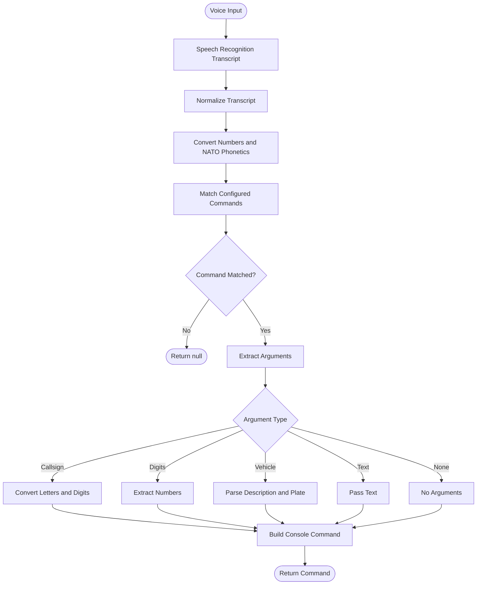

# FiveM Voice Controls

A Stream Deck plugin for sending FiveM commands by voice. Hold the key, speak, release. Speech is transcribed offline with [faster-whisper](https://github.com/SYSTRAN/faster-whisper), turned into a command, and sent to the FiveM client console over TCP.

FiveM client-console connection code in [src/connection.ts](./src/connection.ts)
is adapted from [FXCommands](https://github.com/josh-tf/fxcommands). See
[THIRD_PARTY_NOTICES.md](./THIRD_PARTY_NOTICES.md) for attribution and license
details.

## How it works

1. **Key down:** starts recording from the default microphone.
2. **Key up:** stops recording, transcribes the audio, and parses the text.
3. The command is sent to the FiveM console (default `127.0.0.1:29200`).

The key shows its state: `LISTENING`, `THINKING`, `SENT`, `NO GAME`, `NOT HEARD`, or an error such as `NO MIC`.

### Commands

The default commands:

| Say | Sends |
| --- | --- |
| "Sam Whiskey November Tango one one" | `sam WNT11` |
| "P one two three four" | `p 1234` |
| "Check plate Alpha Bravo Five Charlie One" | `qvr AB5C1` |
| "10-3" / "10-3 K6" | `10-3` / `10-3 K6` |
| "10-2 Latest" / "10-2 OSA" | `10-2 latest` / `10-2 OSA` |
| "10-7" / "10-7 postal 123" / "10-7 OSA" | `10-7` / `10-7 123` / `10-7 OSA` |
| "3t red sedan plate Alpha Bravo Five Charlie One" | `3t red sedan AB5C1` |
| "3t blue SUV plate Kilo Eight Mike Tango" | `3t blue SUV K8MT` |
| "3t plate One Two Three" | `3t 123` |

You can replace them with your own in the key's **Commands** setting, which takes a JSON list. Leave it empty to use the defaults.

```json
[
  { "say": ["sam", "sum", "same"], "send": "sam", "args": "callsign" },
  { "say": ["panic"], "send": "10-10", "args": "none" },
  { "say": ["10-2", "ten two"], "send": "10-2", "args": "none", "options": { "latest": "latest" } },
  { "say": ["3t"], "send": "3t", "args": "vehicle", "required": true, "cooldown": 5 }
]
```

- `say`: words that trigger the command. Add likely mis-hearings. Codes like `10-3` match "ten three" too.
- `send`: the console command to send.
- `args`: how the rest of the speech is read. Each type only converts what it needs, so ordinary words are never turned into letters.
  - `callsign`: letters then digits (`kilo eight` -> `K8`). Anything else is rejected.
  - `plate`: letters and digits in any order, up to 8 characters (`alpha bravo five charlie one` -> `AB5C1`).
  - `vehicle`: a description, then the word `plate` (or `registration`, `rego`), then the plate. The description is kept as spoken.
  - `digits`: numbers only. `text`: the words exactly as spoken. `none`: no arguments.
- `options` (optional): spoken keyword -> text sent after the command, e.g. `"osa": "OSA"`.
- `required` (optional, default `false`): reject the command if the argument (the plate for `vehicle`) is missing.
- `minLength` / `maxLength` (optional): limit the length of the argument.
- `cooldown` (optional): seconds an identical command is ignored. Overrides the **Cooldown** setting.

Anything that matches no command, or has an invalid argument, is reported as `NOT HEARD`. An invalid list shows `BAD CONFIG` on the key. See [voice-parser.ts](src/voice-parser.ts).

### Corrections and vocabulary

Both are JSON objects in the key's settings.

- **Corrections** rewrite phrases in the transcript before anything else, e.g. `{ "salm": "sam", "check plait": "check plate" }`.
- **Vocabulary** teaches extra letter or number words, e.g. `{ "niner": "9", "alfa": "A" }`.

### Confidence and debugging

**Min confidence %** rejects speech the recogniser is unsure about (`LOW CONF` on the key). Start around 50 and adjust. With **Debug** ticked, `voice/debug/last-parse.txt` shows how each word was interpreted, including the confidence.
## Install

Download a file from the [Releases](../../releases) page and double-click it. Stream Deck installs it.
Both release packages include `THIRD_PARTY_NOTICES.md`.

| File | Pick this if |
| --- | --- |
| `fivem-voicecontrols-full.streamDeckPlugin` | You don't have Python. Includes its own speech engine (about 110 MB). |
| `fivem-voicecontrols-lite.streamDeckPlugin` | You already have Python 3.9+. Tiny download, but you install the packages yourself (see Requirements). |

Then drag **Voice Command** from the *FiveM-VoiceControls* category onto a key. The first press downloads the speech model (about 150 MB), which the key shows as `DOWNLOADING`.

Windows may warn about an unknown publisher on the Full version, because the bundled engine isn't code-signed. Choose "More info", then "Run anyway". Some antivirus tools may also flag or remove it. If so, use the Lite version.

## Requirements

- Stream Deck 7.1+ (Windows 10+ or macOS 12+)
- A FiveM client with the console TCP port enabled
- **Lite version only:** Python 3.9+ with the speech packages:

  ```
  pip install faster-whisper numpy sounddevice
  ```

  If Python isn't on your PATH, enter its full path in the **Python** setting. The key shows `NO PYTHON` when Python can't be found and `PIP INSTALL` when the packages are missing.

The Full version is built for Windows only.

## Building from source

Needs Node.js 24, the Stream Deck CLI (`npm i -g @elgato/cli`) and, for the Lite listener, the Python packages above.

```
npm install
streamdeck link nz.tigerjess12.fivem-voicecontrols.sdPlugin
npm run build
```

`streamdeck link` makes Stream Deck load the plugin directly from this folder, so builds take effect without copying files. For development, `npm run watch` rebuilds and restarts the plugin on every change.

To build both release files into `release/`:

```
pip install pyinstaller
powershell -ExecutionPolicy Bypass -File scripts/build-release.ps1
```

Pushing a tag such as `v0.1.0` runs the same build in GitHub Actions and attaches both files to the release. `python -m PyInstaller` is used because `pyinstaller` is often not on PATH.

## Settings

| Setting | Default | Description |
| --- | --- | --- |
| Python | `python` | Python executable that has the dependencies installed (Lite version only) |
| Microphone | System default | Input device to record from. The list is filled in by your Python install, so set **Python** first and reopen the panel if the list is empty. If the saved microphone is unplugged, the system default is used |
| Model | `base.en` | Whisper model size |
| Console port | `29200` | FiveM console port |
| Commands | built-in | JSON command list (see above) |
| Corrections | none | JSON phrase corrections (see above) |
| Vocabulary | none | JSON extra letter/number words (see above) |
| Min confidence % | `0` (off) | Reject speech below this confidence |
| Cooldown (sec) | `0` (off) | Ignore the same command repeated within this time |
| Debug | off | Save the last recording, its transcript and parse trace to `voice/debug/` (`last.wav`, `last.txt`, `last-parse.txt`) |

## Privacy

Speech recognition runs entirely on your PC. Audio is held in memory only and is never written to disk unless **Debug** is ticked.

## Speech model

The model is not bundled. On first use it is downloaded (about 150 MB for `base.en`) and the key shows `DOWNLOADING`. It is stored in `%APPDATA%\FiveM-VoiceControls\models` on Windows (`~/Library/Application Support/FiveM-VoiceControls/models` on macOS), so it survives plugin updates. Delete that folder to remove it.

## Project layout

- [src/plugin.ts](src/plugin.ts): plugin entry point
- [src/actions/voice-command.ts](src/actions/voice-command.ts): key action and Python listener process
- [src/voice-parser.ts](src/voice-parser.ts): command config and transcript parsing
- [src/connection.ts](src/connection.ts): FiveM console connection
- [nz.tigerjess12.fivem-voicecontrols.sdPlugin/voice/listener.py](nz.tigerjess12.fivem-voicecontrols.sdPlugin/voice/listener.py): push-to-talk recogniser
- [nz.tigerjess12.fivem-voicecontrols.sdPlugin/ui/voice-command.html](nz.tigerjess12.fivem-voicecontrols.sdPlugin/ui/voice-command.html): settings panel

## Troubleshooting

- **Changes don't appear in Stream Deck:** make sure the plugin is linked, not copied (`streamdeck link`), then restart the Stream Deck app.
- **`NO PYTHON` / `PIP INSTALL`:** see Requirements.
- **`MODEL FAIL`:** the model download failed. Check your internet connection and try again.
- **`NO MIC`:** the microphone couldn't be opened. Check your default input device and OS microphone permissions.
- **`NO GAME`:** FiveM isn't running or the console port doesn't match.
- Logs are in `nz.tigerjess12.fivem-voicecontrols.sdPlugin/logs`.


## How It Works

The voice parser converts spoken commands into executable FiveM console commands.

It uses speech normalization, NATO phonetic recognition, number conversion and configurable command rules to interpret speech and construct the appropriate command.

### Processing Flow


